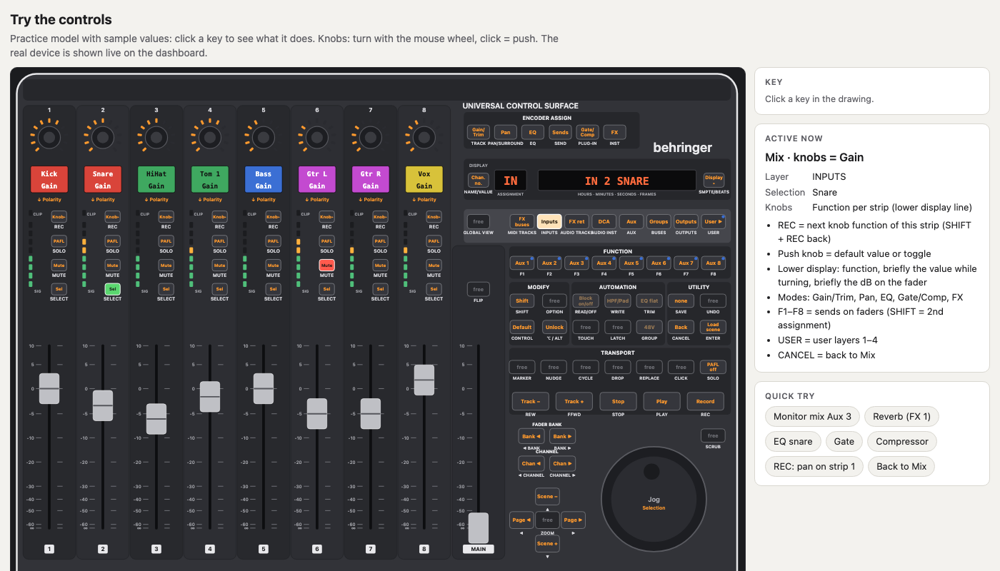

# Surface Control for SQ

**Use a Behringer X-Touch as a control surface for Allen & Heath SQ mixers** – macOS and Windows, English and German.

[Download](https://github.com/dressler-apps/X-TouchControlSQ/releases/latest) · [Documentation & interactive demo](https://dressler-apps.github.io/X-TouchControlSQ/) · [Report an issue](https://github.com/dressler-apps/X-TouchControlSQ/issues/new/choose)

## What it does

Surface Control for SQ connects a **Behringer X-Touch** (Mackie Control mode, USB) over the network to an **Allen & Heath SQ5 / SQ6 / SQ7**:

- Motor faders following the console, channel names and colours on the displays, meters, mute, PAFL, selection (follows the console and MixPad)
- **REC** steps the knob function per strip (input: Gain → Pan → HPF → Trim), push = default value
- Knob modes: Gain/Trim, Pan, EQ, Gate/Comp, FX parameters (the effect in each slot is detected from the console)
- Sends on faders (aux and FX), four user layers, scenes, USB player, recording, 48V (with safety interlocks)
- **Every key freely assignable** – including the channel keys (for all strips or per channel type), SQ SoftKeys and Tap Tempo; the SoftKey assignment of the console is shown
- Dashboard with a live picture of the X-Touch, settings, help and release notes – in English or German

## Download

Get the files from the **[latest release](https://github.com/dressler-apps/X-TouchControlSQ/releases/latest)**:

| System | File |
|---|---|
| macOS (Apple Silicon) | `Surface-Control-for-SQ-<version>-mac-arm64.dmg` |
| Windows 10/11, 64-bit – installer | `Surface-Control-for-SQ-<version>-win-x64.exe` |
| Windows – portable, no installation | `Surface-Control-for-SQ-<version>-win-x64-portable.exe` |

**First start – the apps are not signed yet:**
- **macOS:** open the DMG and drag the app to *Applications*. On first start macOS says it cannot be opened: go to *System Settings › Privacy & Security* and click **Open Anyway**. Allow access to the **local network** when asked.
- **Windows:** at *Windows protected your PC* click **More info › Run anyway**.

## Setup

1. Connect the X-Touch via USB in **Mackie Control mode** (hold SELECT 1 while switching on, choose *MC*). Display brightness there with knob 8 – 50 % reads well.
2. Start the app – the dashboard opens. Under *Settings › Console* enter the **IP address of the SQ** and switch on *Console connection active*.
3. **MIDI:** the SQ allows only one MIDI connection. If e.g. a Stream Deck plugin uses it, leave *Use MIDI as well* off – names, colours, meters, selection, PAFL, gain/EQ/dynamics/FX still work over the native network protocol.
4. **MixPad:** switch on *Follow SQ Channel Select* and *Follow SQ Mix Select* so MixPad follows the selection.
5. Language: *Settings › Advanced › Language*.

Full operating guide and an **interactive demo** you can click through: **[documentation](https://dressler-apps.github.io/X-TouchControlSQ/)**.

## Bugs and feature requests

Please open an **[issue](https://github.com/dressler-apps/X-TouchControlSQ/issues/new/choose)** – include the version (top left in the app), your system and the console firmware. In the app: *Help › Report an issue …*.

---
*Behringer, X-Touch, Allen & Heath and SQ are trademarks of their respective owners. This project is not affiliated with or endorsed by them.*
