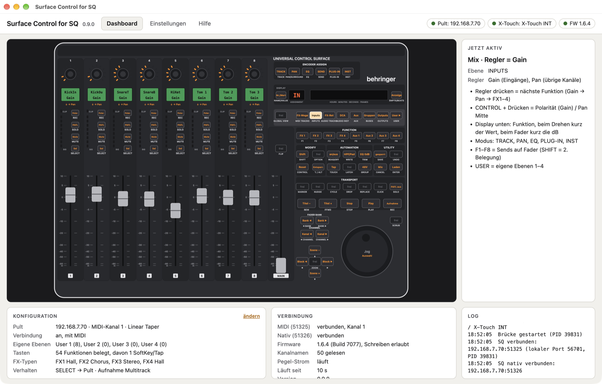

# Surface Control for SQ

**Behringer X-Touch als Bedienoberfläche für Allen & Heath SQ-Pulte** · *Behringer X-Touch as a control surface for Allen & Heath SQ mixers*

[Deutsch](#deutsch) · [English](#english) · [Downloads](https://github.com/haukedressler/X-TouchControlSQ/releases/latest) · [Doku / Docs](https://haukedressler.github.io/X-TouchControlSQ/) · [Fehler melden / Report an issue](https://github.com/haukedressler/X-TouchControlSQ/issues/new/choose)

---

## Deutsch

Surface Control for SQ verbindet ein **Behringer X-Touch** (Mackie-Control-Modus, USB) über das Netzwerk mit einem **Allen & Heath SQ5/SQ6/SQ7**. Motorfader, Displays mit Namen und Farben vom Pult, Pegelanzeigen, Mute, PAFL, Auswahl, Gain/Pan/HPF/Trim je Zug, EQ, Gate, Compressor, FX-Parameter, Sends auf Fadern, Szenen, USB-Player – und alle Tasten frei belegbar.

### Download
Auf der Seite **[Releases](https://github.com/haukedressler/X-TouchControlSQ/releases/latest)**:

| System | Datei |
|---|---|
| macOS (Apple Silicon, ab macOS 14) | `Surface-Control-for-SQ-<Version>-mac-arm64.dmg` |
| Windows 10/11 (64 Bit), Installation | `Surface-Control-for-SQ-<Version>-win-x64.exe` |
| Windows, ohne Installation (portable) | `Surface-Control-for-SQ-<Version>-win-x64-portable.exe` |

**Erster Start – die Apps sind (noch) nicht signiert:**
- **macOS:** DMG öffnen, App in „Programme“ ziehen. Beim ersten Start meldet macOS „kann nicht geöffnet werden“: in *Systemeinstellungen › Datenschutz & Sicherheit* unten „Trotzdem öffnen“ wählen. Die Frage nach dem **lokalen Netzwerk** mit „Erlauben“ beantworten.
- **Windows:** Bei „Der Computer wurde durch Windows geschützt“ auf *Weitere Informationen › Trotzdem ausführen*.

### Einrichten
1. X-Touch im **Mackie-Control-Modus** per USB anschließen (beim Einschalten SELECT 1 halten, Modus „MC“). Display-Helligkeit dort mit Regler 8, 50 % ist gut lesbar.
2. App starten – das Dashboard öffnet sich. Unter *Einstellungen › Pult* die **IP-Adresse des SQ** eintragen und „Pult-Verbindung aktiv“ einschalten.
3. **MIDI:** Das SQ erlaubt nur eine MIDI-Verbindung. Läuft parallel z. B. ein Stream-Deck-Plugin, „MIDI mitbenutzen“ ausgeschaltet lassen.
4. Sprache: *Einstellungen › Erweitert › Sprache* (Deutsch/English).

Bedienung, Tastenbelegung und interaktive Demo: **[Doku](https://haukedressler.github.io/X-TouchControlSQ/)**. Neuigkeiten je Version: Klick auf die Versionsnummer oben links in der App oder [Releases](https://github.com/haukedressler/X-TouchControlSQ/releases).

### Fehler und Wünsche
Bitte als **[Ticket (Issue)](https://github.com/haukedressler/X-TouchControlSQ/issues/new/choose)** melden – mit Version (oben links in der App), System und Pult-Firmware.

---

## English

Surface Control for SQ connects a **Behringer X-Touch** (Mackie Control mode, USB) over the network to an **Allen & Heath SQ5/SQ6/SQ7**. Motor faders, displays with names and colours from the console, meters, mute, PAFL, selection, gain/pan/HPF/trim per strip, EQ, gate, compressor, FX parameters, sends on faders, scenes, USB player – and every key freely assignable.

### Download
On the **[Releases](https://github.com/haukedressler/X-TouchControlSQ/releases/latest)** page:

| System | File |
|---|---|
| macOS (Apple Silicon, macOS 14 or later) | `Surface-Control-for-SQ-<version>-mac-arm64.dmg` |
| Windows 10/11 (64-bit), installer | `Surface-Control-for-SQ-<version>-win-x64.exe` |
| Windows, no installation (portable) | `Surface-Control-for-SQ-<version>-win-x64-portable.exe` |

**First start – the apps are not signed (yet):**
- **macOS:** open the DMG, drag the app to “Applications”. On first start macOS says it “cannot be opened”: go to *System Settings › Privacy & Security* and choose “Open Anyway”. Answer the **local network** question with “Allow”.
- **Windows:** at “Windows protected your PC” click *More info › Run anyway*.

### Setup
1. Connect the X-Touch via USB in **Mackie Control mode** (hold SELECT 1 while switching on, mode “MC”). Display brightness there with knob 8, 50 % reads well.
2. Start the app – the dashboard opens. Under *Settings › Console* enter the **IP address of the SQ** and switch on “Console connection active”.
3. **MIDI:** the SQ allows only one MIDI connection. If e.g. a Stream Deck plugin runs at the same time, leave “Use MIDI as well” off.
4. Language: *Settings › Advanced › Language* (Deutsch/English).

Operation, key assignment and interactive demo: **[Docs](https://haukedressler.github.io/X-TouchControlSQ/)**. What's new per version: click the version number at the top left of the app or see [Releases](https://github.com/haukedressler/X-TouchControlSQ/releases).

### Bugs and wishes
Please report them as an **[issue](https://github.com/haukedressler/X-TouchControlSQ/issues/new/choose)** – with version (top left in the app), system and console firmware.

---
*Behringer, X-Touch, Allen & Heath and SQ are trademarks of their respective owners. This project is not affiliated with them.*
